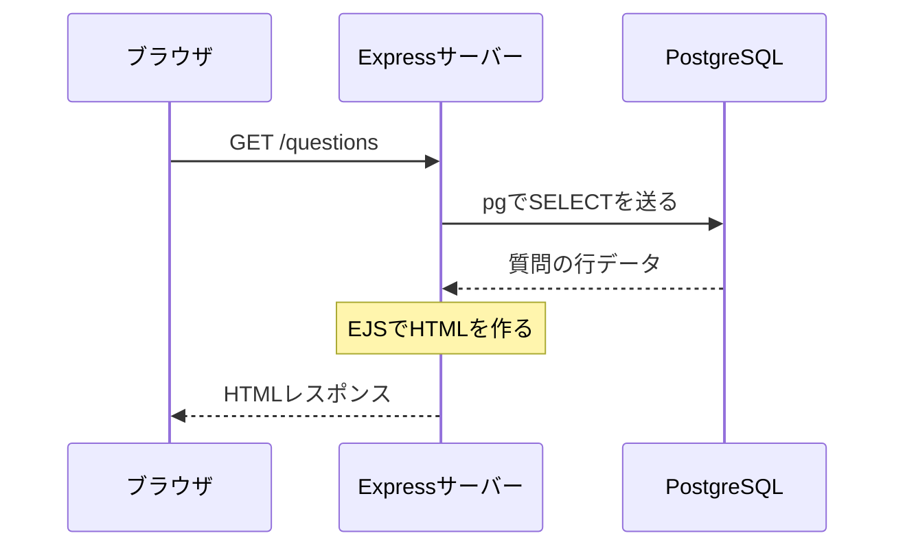

# 第1回：Webアプリの全体像

目標：ブラウザ・サーバー・DBの役割と、質問一覧が届く流れを説明する。

## 基礎

ブラウザはHTTPで「この画面が欲しい」と要求する。Node.jsで動くExpressが要求を受け、必要なデータをpg経由でPostgreSQLへ問い合わせる。EJSでデータをHTMLへ埋め込み、そのHTMLを返す。ブラウザはHTMLを表示する。

Node.jsはJavaScriptの実行環境、Expressは要求を処理するライブラリ、pgはDBと通信するライブラリ。PostgreSQLはデータを保存するDB、EJSはHTMLを生成するテンプレート。

## 実コード

- [server.js](../../server.js) 1〜8行：`require`で関数を読み込み、`createPool()`で接続プールを作り、接続を確認して `createApp(pool).listen(...)` で待ち受ける。
- [db/pool.js](../../db/pool.js)：接続プールは接続を管理・再利用する仕組み。接続文字列の値は教材や画面共有へ出さない。
- [app.js](../../app.js) 10〜25行：ExpressとEJSを設定。94〜113行：`app.get('/questions', ...)` でSQL取得後、`res.render('index', ...)` でHTMLを生成する。
- [views/index.ejs](../../views/index.ejs)：取得した質問をHTMLへ埋め込む。

`await pool.query(...)` はDBの処理結果を待つ。`const { rows } = ...` は結果オブジェクトから行データの配列を取り出す書き方。
`server.js` は起動準備であり、毎回の質問一覧取得は `app.js` のルート処理で行う。

## 理解確認（一問ずつ）

1. 質問一覧のDB問い合わせを実行するのはブラウザとExpressサーバーのどちら？ なぜ？
2. Node.js・Express・pg・PostgreSQL・EJSを、それぞれ一文で説明すると？
3. `pool.query` の結果が、そのまま画面に表示される？ HTMLになる場所はどこ？

## 本人操作・メモ

公開アプリで質問一覧を開き、GitHubで `GET /questions`・`pool.query`・`res.render` を順に指す。画面を開けたことと仕組みを説明できたことを別々に [進捗](PROGRESS.md) に残す。
